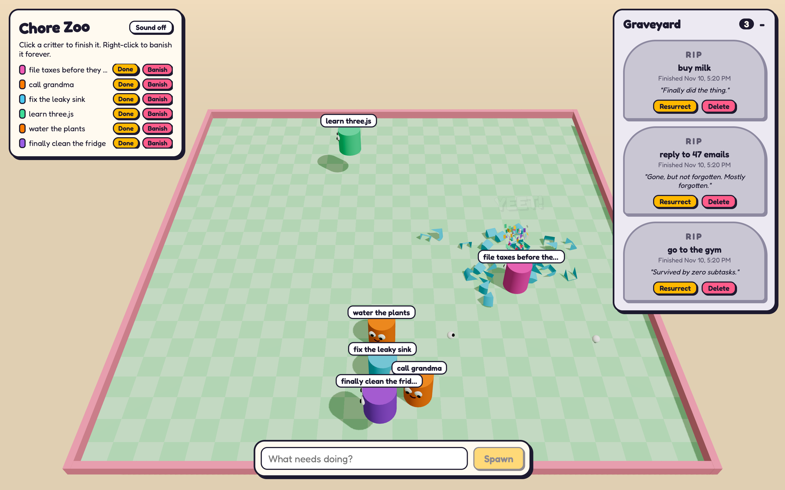

# Chore Zoo

[English](README.md) | 日本語

ToDo の一つひとつが、ギョロ目の円柱になって 3D の囲いの中を跳ね回る ToDo アプリです。



> **このリポジトリは完全にバイブコーディングで作られています。** コードはすべて [Claude Code](https://claude.com/claude-code) がチャットでのプロンプトをもとに書いたもので、手書きのコードはありません。使ったプロンプトは [PROMPTS.ja.md](PROMPTS.ja.md) にまとめています。

- 円柱をクリック（または **Done**）すると完了になり、円柱が砕けて墓場に墓石が立ちます。
- 円柱を右クリック（または **Banish**）すると削除され、ブーツでポータルに蹴り込まれます。
- 墓場からは ToDo を復活させることも、完全に削除することもできます。

## 構成

- `packages/shared` – API と Web アプリで共有する型
- `apps/api` – Hono + `node:sqlite`。ToDo を `apps/api/data/todos.db` に保存
- `apps/web` – Vite + React Three Fiber + Rapier

## 起動方法

```sh
npm install
npm run dev
```

Web アプリは http://localhost:5173 で起動し、`/api` へのリクエストはポート 8787 の API に転送されます。
