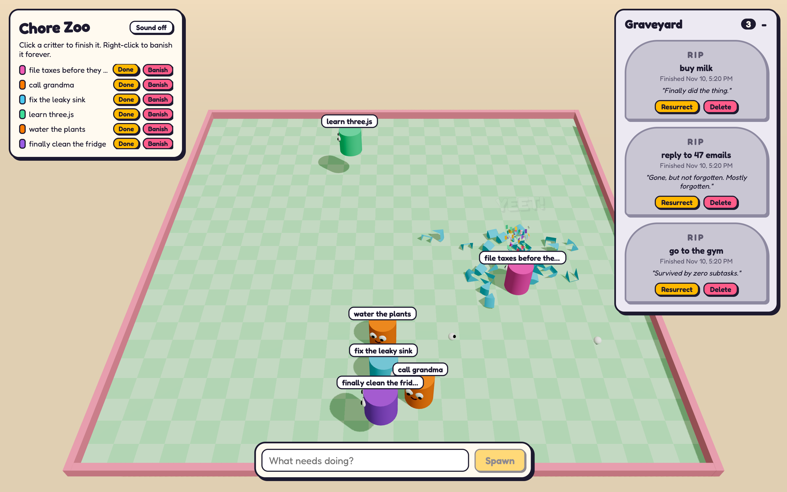

# Chore Zoo

English | [日本語](README.ja.md)

A todo list where every todo is a googly-eyed cylinder hopping around a 3D pen.



> **This repo is fully vibe coded.** All of the code was written by [Claude Code](https://claude.com/claude-code) from chat prompts, with no code written by hand. The prompts used are listed in [PROMPTS.ja.md](PROMPTS.ja.md) (Japanese).

- Click a critter (or **Done**) to finish it: it shatters and gets a tombstone in the graveyard.
- Right-click a critter (or **Banish**) to delete it: a boot kicks it into a portal.
- From the graveyard you can resurrect a todo or delete it for good.

## Layout

- `packages/shared` – types shared by the API and the web app
- `apps/api` – Hono + `node:sqlite`, stores todos in `apps/api/data/todos.db`
- `apps/web` – Vite + React Three Fiber + Rapier

## Running

```sh
npm install
npm run dev
```

The web app runs on http://localhost:5173 and proxies `/api` to the API on port 8787.

